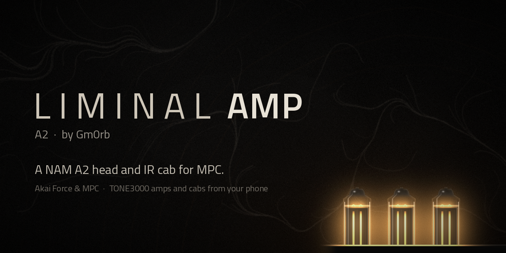
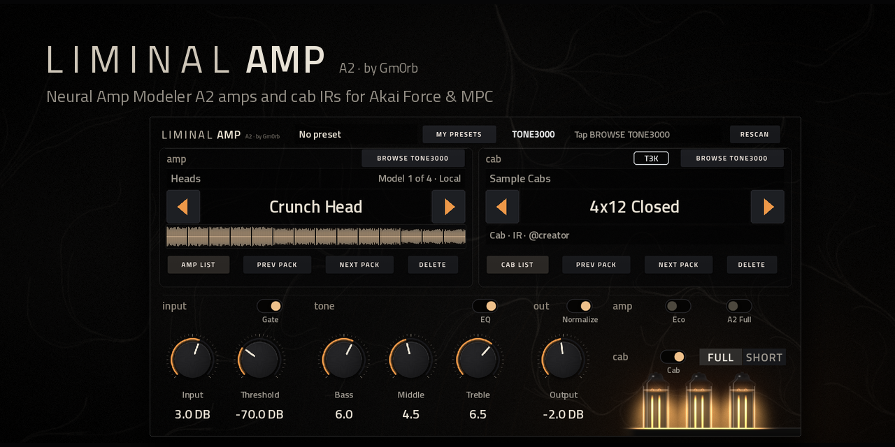
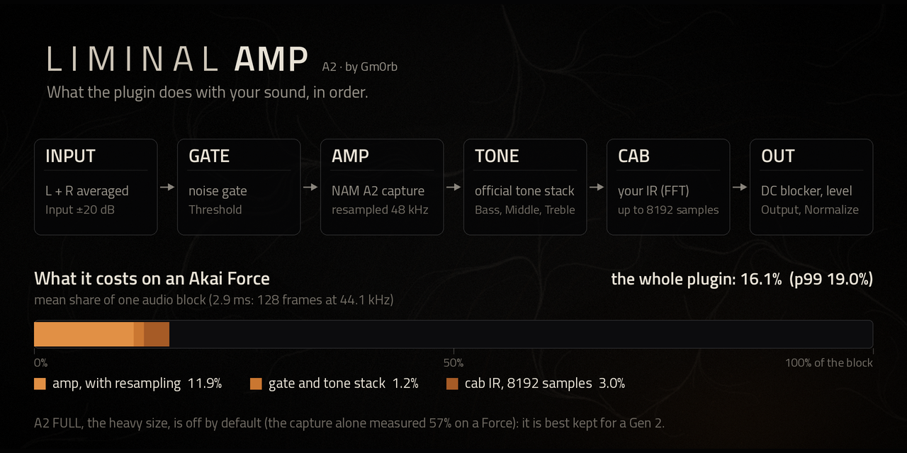
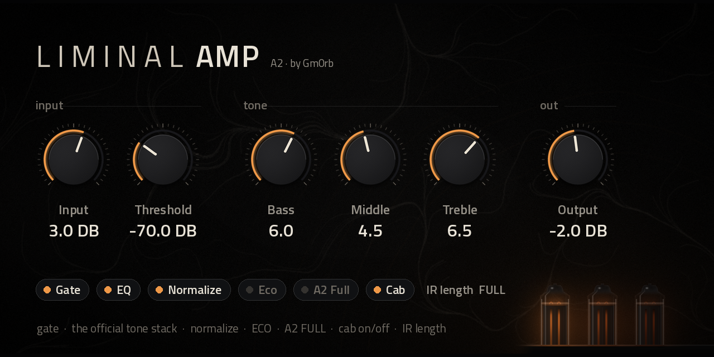
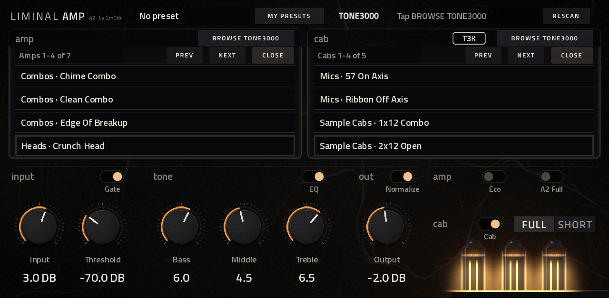
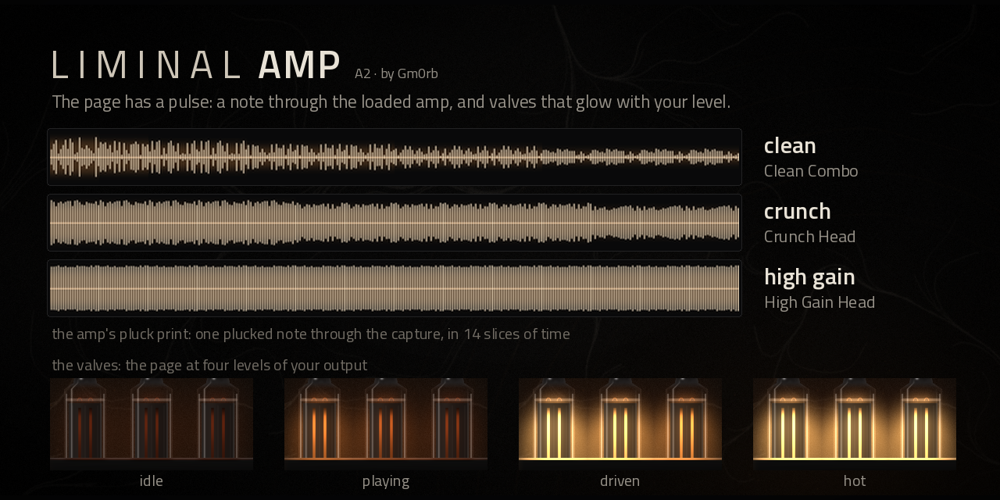
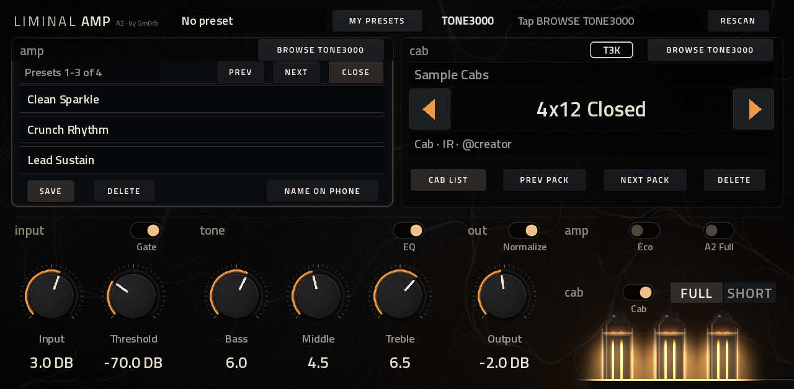
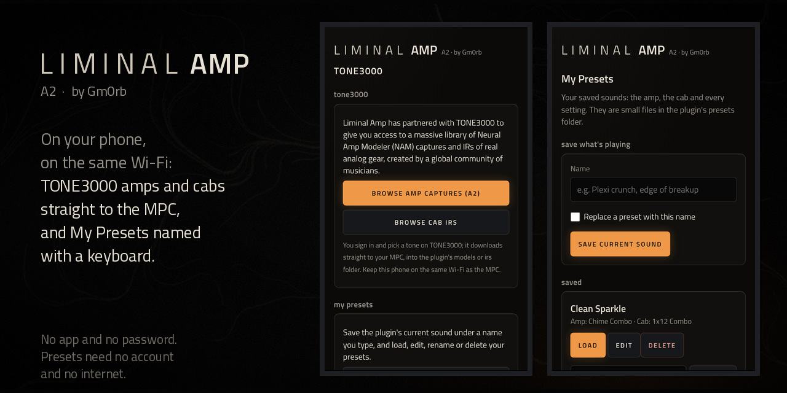
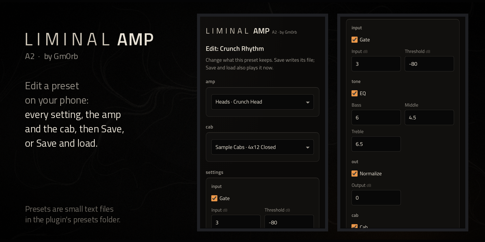

[](docs/images/banner.png)

# Liminal Amp for MPC OS

*A NAM A2 head and IR cab for MPC.*

**A lightweight, official-sound Neural Amp Modeler for Gen 1 Akai MPC and Force.** One job, done faithfully: run
[Neural Amp Modeler](https://github.com/sdatkinson/NeuralAmpModelerCore) A2 captures through a noise gate, the official
tone stack and a cabinet IR, as the official NAM plugin processes them, at the lowest CPU cost we could measure. Browse
your captures and IRs on the touchscreen, download more from TONE3000 from your phone, and keep your rigs as **My
Presets**. A companion to [Liminal Hz](https://github.com/gmorb/mpc-vst-liminal-hz), the convolution reverb.
Not affiliated with or endorsed by the Neural Amp Modeler project, TONE3000 or Akai Professional.

## What it looks like



One page, made for the MPC's touchscreen, with nothing hidden on other tabs:
- **Top**: the plugin name, **MY PRESETS**, the TONE3000 strip with its status line, and **RESCAN**.
- **Left, the amp**: its pack, the capture's name with **◀ ▶** to step through the list, its details, and the amp's
  **pluck print** (below). **AMP LIST**, **PREV PACK / NEXT PACK** and **DELETE** (it asks twice) sit under it, and
  **BROWSE TONE3000** above it.
- **Right, the cab**: the same for the cabinet IR, with **CAB LIST**.
- **Below**: the **input**, **tone** and **out** knobs, each group with its switch above; **Eco** and **A2 Full** for the
  amp; **Cab** and the IR length for the cab; and, lower right, three valves that glow with your level.

*The images in this README show the plugin's own text, lists and glow, drawn from a card of sample files made for them
(`tools/make_readme_images.py`): the amp and cab names are made up and no third-party captures are used.*

## What it does



- **Sounds like the official plugin.** Captures are trained at 48 kHz and MPC runs at 44.1 kHz: this plugin
  resamples around the model, as NeuralAmpModelerPlugin does, so a capture's EQ and dynamics sit where the capture
  put them. Cab IRs are resampled to the host rate and used up to 8192 samples, and the noise gate and tone stack
  are the official plugin's own code.
- **Light on the CPU.** NAM Core's A2 fast path for the amp, and FFT convolution for the cab IR: an 8192-sample
  IR adds about 3% of an audio block on a Force, where direct convolution would cost many times that.
- **Nothing on the audio thread but audio.** Files are scanned and loaded in the background and handed over
  without locks; the audio thread never allocates, waits or touches the disk.
- **Portable.** One folder with the plugin, its page and (optionally) your files; it also finds `models` and
  `irs` folders anywhere on the device's drives ([docs/SELF_CONTAINED_PORTS.md](docs/SELF_CONTAINED_PORTS.md)).

## The controls



- **input**: **Input** (±20 dB) into the amp, and the noise **Gate** with its **Threshold** (−100 to 0 dB).
- **tone**: **Bass**, **Middle** and **Treble** (0-10), the official plugin's tone stack (a bass shelf at 150 Hz, a
  mid peak at 425 Hz, a treble shelf at 1800 Hz), with the **EQ** switch to bypass it.
- **out**: **Output** (±40 dB), and **Normalize**, which sets the level from each capture's own measured loudness
  (to −18 dB), so changing amps keeps the volume about the same.
- **cab**: the **Cab** switch, and the IR length: **FULL** (up to 8192 samples) or **SHORT** (4096, a little cheaper).
- **amp**: **Eco** and **A2 Full**, [below](#eco-and-a2-full).

## AMP LIST and CAB LIST



For long lists, so you don't have to tap ◀ ▶ over and over: tap **AMP LIST** or **CAB LIST** and every capture or IR
covers its block, four to a page as "pack · name". Tap a row to load it (the one in use is outlined); **PREV / NEXT**
turn the pages; **CLOSE** puts the block back. The list opens on the page of the one in use and stays open when you
pick, so you can try one after another. Both can be open at once. Names too long for their row slide along slowly
until their end shows.

The folders found last time are remembered (hidden `.models-index` and `.irs-index` files in the plugin folder), so a
project's amp and cab load as soon as the plugin opens, before the full search of the cards finishes.

## See the amp: the pluck print and the valves



- **The pluck print** shows what the loaded amp does to a note. When a capture loads, one plucked string is played
  through it (the capture alone, 1.2 s of audio, in the background) and drawn under the amp's name in 14 slices of
  time: a clean amp shows a sharp attack that fades, crunch holds the note and evens its peaks, and high gain is a
  solid wall. It is a picture of the capture, not a meter, so it doesn't move while you play.
- **The valves**, lower right, show your output level: the heaters glow dull red in silence and heat up one after
  another as you play, cooling over about 2.5 seconds once you stop.

*The three prints above are the engine's own, for three small test captures of known drive (clean, soft clip, hard
clip) made by `tools/make_readme_images.py`.*

## My Presets



Set the rig the way you like it, then keep it. Tap **MY PRESETS**; a list opens over the amp block, three presets to a
page, with **PREV / NEXT / CLOSE** as in the lists above:
- **SAVE** keeps the whole rig: every setting, the amp and the cab. It is named after its amp ("Plexi Crunch",
  "Plexi Crunch 2"...) and selected.
- Tap a row to load that preset. The amp and cab are found again even if a card moved; if one is gone the settings
  still apply and the page says which. The header shows the preset in use ("My: <name>"), and a project remembers it.
- **DELETE** removes the selected preset: it asks twice, and deletes the file permanently.
- **NAME ON PHONE**: the MPC's screen has no keyboard, so names are typed on your phone (below).
- Each preset is a small text file in the plugin's `presets/` folder (`<name>.na2p`), kept across upgrades. You can
  also rename or delete the files from a computer; press **RESCAN** and the list follows.

## Your phone: TONE3000 and presets



The plugin serves small pages to a phone (or computer) on the same Wi-Fi as the MPC, in the plugin's own look. No app
to install and no password; each page closes by itself after 15 idle minutes.
- Tap **BROWSE TONE3000** on the amp or the cab and the status line at the top shows an address such as
  `192.168.1.20:8091`: open it on your phone. It starts TONE3000's own sign-in and picker, so you search and choose on
  TONE3000 itself: **A2 captures** for the amp, **cab IRs** for the cab. The tone downloads straight to the MPC, into
  the plugin's `models/TONE3000/<tone>/` or `irs/TONE3000/<tone>/` folder, with its creator and licence kept beside
  it, and is selected when it's done. Nothing about your TONE3000 account is stored on the device.
- The same page has **My Presets: name, save & edit**, which needs no internet: type a name and **Save current
  sound**, or **Load**, **Edit**, **Rename** and **Delete** any preset. **NAME ON PHONE** in the My Presets list opens
  it directly (the address then ends in `/presets`).
- The first TONE3000 download needs the device's libcurl; without it the status line says "Needs libcurl" and
  everything else still works.

### Edit a preset on your phone



**Edit** opens a preset's amp and cab (chosen from the plugin's own lists) and every setting, grouped as on the MPC
(input, tone, out, cab, amp). **Save** writes its file; **Save and load** also plays it now.

## Eco and A2 Full


- **Eco** (off by default) runs the capture at MPC's 44.1 kHz without resampling: lower CPU, but the capture's tone
  shifts slightly (about 8% lower in frequency), so the official sound stays the default.
- **A2 Full** (off by default) plays an A2 capture at its Full size (8 channels) instead of Lite (3 channels). On a Gen 1
  Force that is very heavy (the Full size alone takes about 57% of an audio block, and one project measured
  75-80% on MPC's own meter), so it is for simple projects or faster hardware. It **asks twice**: the first tap shows a
  warning in three places ("Tap A2 FULL again to turn on") and stays off; a second tap within six seconds turns it on. Turning it off is one tap. A
  project or preset saved with it on loads it as saved.

## Performance
Measured on an Akai Force (RK3288), 44.1 kHz, 128-frame blocks, % of one audio block on one core:

| | mean | p99 |
|---|---|---|
| A2-Lite capture (with 44.1 <-> 48 kHz resampling) | 11.9% | 13.8% |
| + noise gate + tone stack | 13.1% | 15.0% |
| + 8192-sample cabinet IR (the whole plugin, longest IR) | 16.1% | 19.0% |

Good for one or two instances alongside a project; shorter IRs cost less (IR LENGTH "Short" caps them at 4096
samples). A2-Full measured 57% and is not used unless you turn **A2 Full** on.

On MPC's own CPU meter (which shows its total load and tracks the busier blocks), a Force project at 8-10% went
to 30-34% with a real TONE3000 A2 capture and an IR, and to **27-29% with Eco on**.

## Your own captures and IRs
Put `.nam` captures in a folder named `models` and `.wav` IRs in a folder named `irs`: inside the plugin folder, or
anywhere on the MPC's drives and cards (for example `/media/662522/models`), in packs (subfolders) if you like. IRs may
be any sample rate; a stereo IR is mixed down to mono. The plugin remembers where it found them, so starting up and
**RESCAN** are quick even on a full card.

## Install
Download `Liminal-Amp-for-MPC-OS-<version>.zip` from [Releases](../../releases). Requires SSH access
(modded firmware) and the `Synths` folder with `vstscanner.sh` from the Force VST plugins distribution.
For the **Akai Force with MockbaMod** (memory card at `/media/662522`):

1. Copy the `Gm0rb - VST - Liminal Amp` folder into `/media/662522/Synths`.
2. Put .nam captures in a `models` folder and .wav IRs in an `irs` folder: inside the plugin folder, or
   anywhere on your cards (e.g. `/media/662522/models`).
3. On the device: `sh /media/662522/Synths/vstscanner.sh`. MPC restarts; the plugin is under VST, manufacturer
   "Gm0rb", as "Liminal Amp".

Other firmware and the details: the release's README. The release also has a catalog zip
(`Liminal-Amp-<version>-mpc-armv7.zip`, with `install.sh`) for the MPC OS Plugin Catalog; use one method per device.
Your `models`, `irs` and `presets` folders are kept across upgrades.

**Gen 2 devices (MPC Live III and kin, RK3588 / RK3588S):** the release also has a 64-bit build,
`Liminal-Amp-<version>-mpc-aarch64.zip` (the catalog's installer picks it on a Gen 2 device). Tested under emulation
only so far: see [docs/GEN2.md](docs/GEN2.md).

### Want more?
For a fuller amp rig, see [**NAM** by jacob-sabella](https://github.com/jacob-sabella/mpc-vst-nam), also in the
MPC OS Plugin Catalog: favorites and recents, pitch, delay and reverb, and its own TONE3000 browser on the MPC's
screen. The two install side by side (different plugin IDs, files and pages). This one stays small on purpose:
the amp, the cab and nothing else in the signal path, as close to the official plugin as MPC allows.

## How it works
- `engine/nam_engine.*`: the official plugin's chain around NAM Core: input -> noise-gate trigger -> model (A2 at
  its Lite size, Lanczos-resampled 44.1 <-> 48 kHz) -> noise-gate gain -> tone stack -> cabinet IR -> 5 Hz DC
  blocker -> output. Models and IRs are handed to the audio thread without locks; it never allocates or waits.
- `engine/ir_convolver.*`: the cabinet IR as uniformly partitioned FFT convolution (PFFFT, NEON on the device):
  the same result as the official plugin's direct convolution (checked against it: `tools/ir_test.cpp`) at a
  small fraction of the cost.
- `engine/library.*`: finds `models`/`irs` folders in the plugin's folder and under `/media`, with POSIX
  large-file directory calls (a 32-bit program's plain `readdir` and the C++ library's `std::filesystem` fail
  with EOVERFLOW on filesystems with 64-bit directory offsets), and keeps the quick-start index.
- `engine/tone3000.*`, `engine/http.*`, `engine/pkce.*`: TONE3000's Select flow (OAuth 2.0 + PKCE) served to a
  phone from a small LAN page, then downloads with the device's own libcurl (loaded only when used). Tested end to end
  against `tools/t3k_mock.py`, a strict stand-in (PKCE, one-time codes, client id, Bearer tokens).
- `engine/presets.*`, `engine/presets_web.*`, `engine/web_theme.h`: My Presets and the phone pages' look.
- `vst/nam_vst.cpp`: the VST2 wrapper (no Steinberg SDK): parameters, a worker thread that scans and loads,
  browsing, and the project state (files kept by path, relative path and name).
- `vst/layout.conf`: the page, built with [mpc-vst-plugins](https://github.com/sd88me/mpc-vst-plugins);
  `tools/make_art.py` draws its artwork (the material, valves, knobs, pluck print).
- Upstream code is vendored unchanged except one marked speed fix in the resampler ([src/VENDORED.md](src/VENDORED.md)).

## Build and test
```
git clone https://github.com/sd88me/mpc-vst-plugins ../mpc-vst-plugins
git -C ../mpc-vst-plugins checkout 3e50b052268d81e6c61a17a1390ced62f0fdff74   # as in .github/workflows/build.yml
sudo apt install libeigen3-dev qemu-user libc6-armhf-cross
pip install ziglang==0.16.0 pillow playwright && python3 -m playwright install --with-deps chromium
vst/build.sh              # the device plugin (armhf), its page and plugin-list entry
vst/build.sh host         # the same plugin for this PC
tools/test.sh             # library, IR vs the official convolver, engine, My Presets, plugin (with a TONE3000 mock)
SANITIZE=asan tools/test.sh ; SANITIZE=tsan tools/test.sh   # memory and thread checks
ARM=1 tools/test.sh       # also the device .so under qemu-arm (slow)
REPO=<you>/mpc-vst-liminal-amp tools/package.sh   # release zips
```
Test inputs are generated (`tools/make_test_models.py`: A2-shaped models with random weights, synthetic IRs);
no third-party captures are in the repository. CI runs all of the above on every push and makes a draft release
for a `v*` tag.

The README images are made by `tools/make_readme_images.py` (see its header): it runs the built host plugin
under `tools/readme_demo.cpp` with a card of generated sample files, draws the page with `tools/honest_preview.py`,
and screenshots the plugin's phone pages (needs `pip install numpy scipy`, `vst/build.sh host` first).
What changed in each version: [CHANGELOG.md](CHANGELOG.md).

## Licence
MIT ([LICENSE](LICENSE)). Every component compiled in, with its licence: [NOTICE.md](NOTICE.md).
